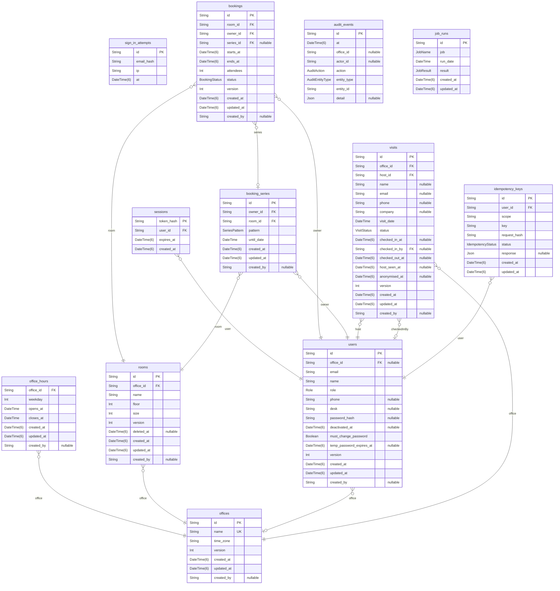

# E-001 room booking: data model

> Generated by [`prisma-markdown`](https://github.com/samchon/prisma-markdown)

- [default](#default)

## default

### `offices`

Properties as follows:

- `id`:
- `name`:
- `time_zone`:
- `version`:
- `created_at`:
- `updated_at`:
- `created_by`:

### `office_hours`

Properties as follows:

- `office_id`:
- `weekday`:
- `opens_at`:
- `closes_at`:
- `created_at`:
- `updated_at`:
- `created_by`:

### `rooms`

Properties as follows:

- `id`:
- `office_id`:
- `name`:
- `floor`:
- `size`:
- `version`:
- `deleted_at`:
- `created_at`:
- `updated_at`:
- `created_by`:

### `users`

Properties as follows:

- `id`:
- `office_id`:
- `email`:
- `name`:
- `role`:
- `phone`:
- `desk`:
- `password_hash`:
- `deactivated_at`:
- `must_change_password`:
- `temp_password_expires_at`:
- `version`:
- `created_at`:
- `updated_at`:
- `created_by`:

### `sign_in_attempts`

Properties as follows:

- `id`:
- `email_hash`:
- `ip`:
- `at`:

### `sessions`

Properties as follows:

- `token_hash`:
- `user_id`:
- `expires_at`:
- `created_at`:

### `bookings`

Properties as follows:

- `id`:
- `room_id`:
- `owner_id`:
- `series_id`:
- `starts_at`:
- `ends_at`:
- `attendees`:
- `status`:
- `version`:
- `created_at`:
- `updated_at`:
- `created_by`:

### `booking_series`

Properties as follows:

- `id`:
- `owner_id`:
- `room_id`:
- `pattern`:
- `until_date`:
- `created_at`:
- `updated_at`:
- `created_by`:

### `visits`

Properties as follows:

- `id`:
- `office_id`:
- `host_id`:
- `name`:
- `email`:
- `phone`:
- `company`:
- `visit_date`:
- `status`:
- `checked_in_at`:
- `checked_in_by`:
- `checked_out_at`:
- `host_seen_at`:
- `anonymised_at`:
- `version`:
- `created_at`:
- `updated_at`:
- `created_by`:

### `audit_events`

Properties as follows:

- `id`:
- `at`:
- `office_id`:
- `actor_id`:
- `action`:
- `entity_type`:
- `entity_id`:
- `detail`:

### `idempotency_keys`

Properties as follows:

- `id`:
- `user_id`:
- `scope`:
- `key`:
- `request_hash`:
- `status`:
- `response`:
- `created_at`:
- `updated_at`:

### `job_runs`

Properties as follows:

- `id`:
- `job`:
- `run_date`:
- `result`:
- `created_at`:
- `updated_at`:
