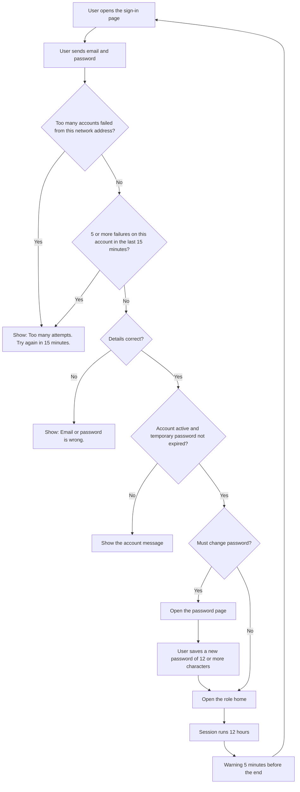

# Room booking workflows

This file shows the main journeys in the room booking app.

## Any role signs in

Any user signs in and lands on the right page. A forced password change comes first.
The journey is the same for every role. Only the landing page differs.

| Role | Role home |
|---|---|
| Platform admin | Offices |
| Office admin | Reception |
| Receptionist | Reception |
| Employee | Rooms |

Related rules: E-001/AC-47, AC-48, AC-49, AC-71, AC-72, AC-84, AC-85.
