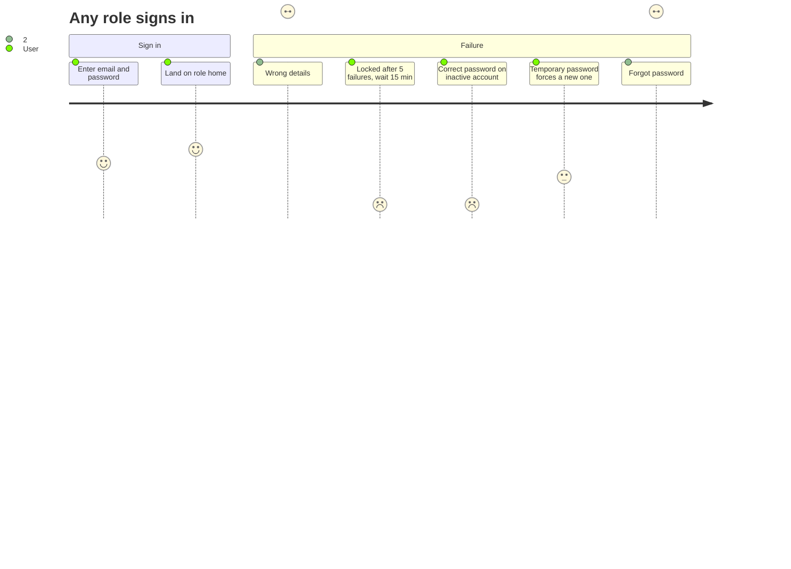
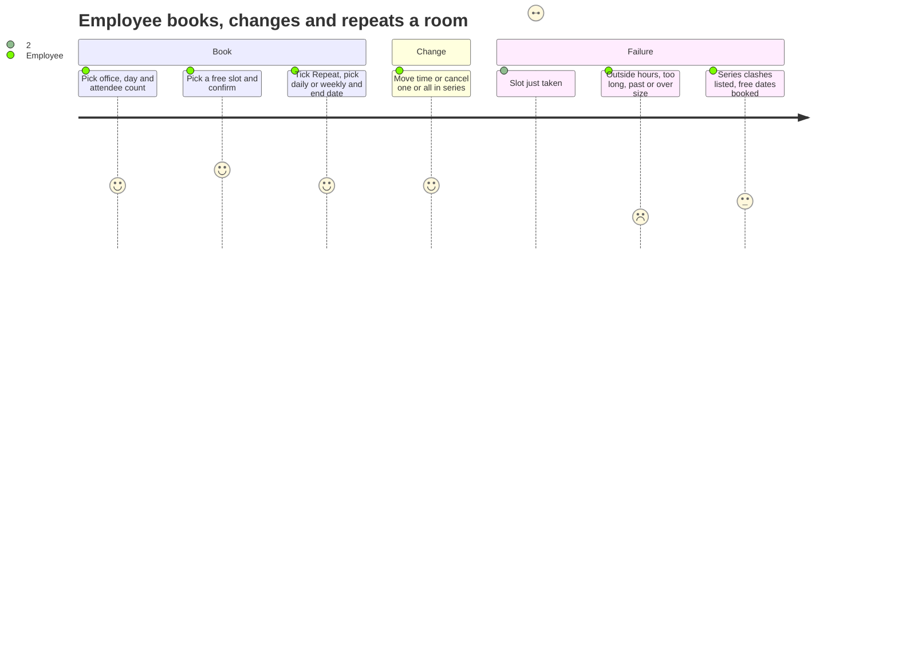
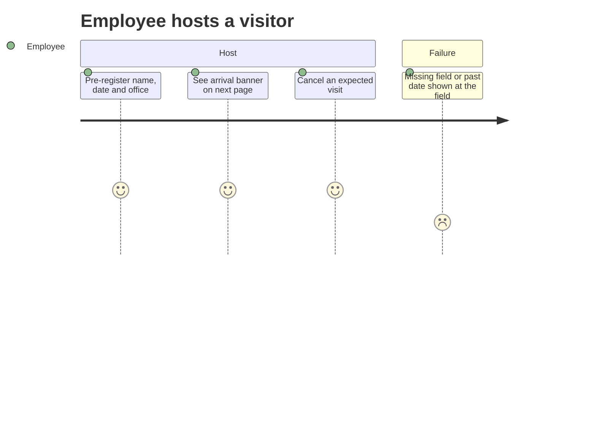
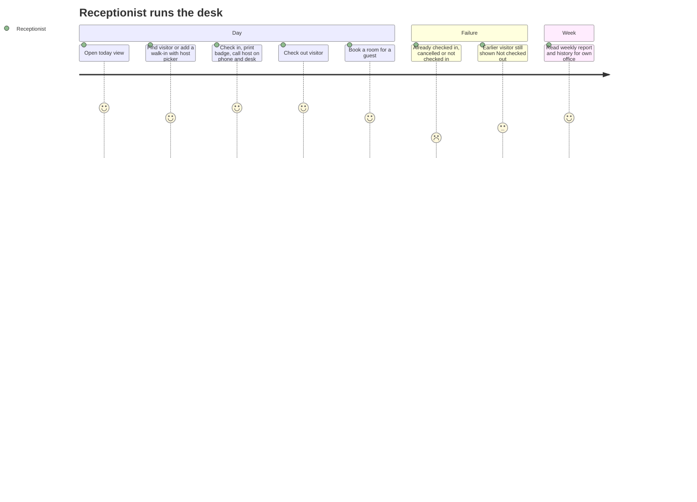
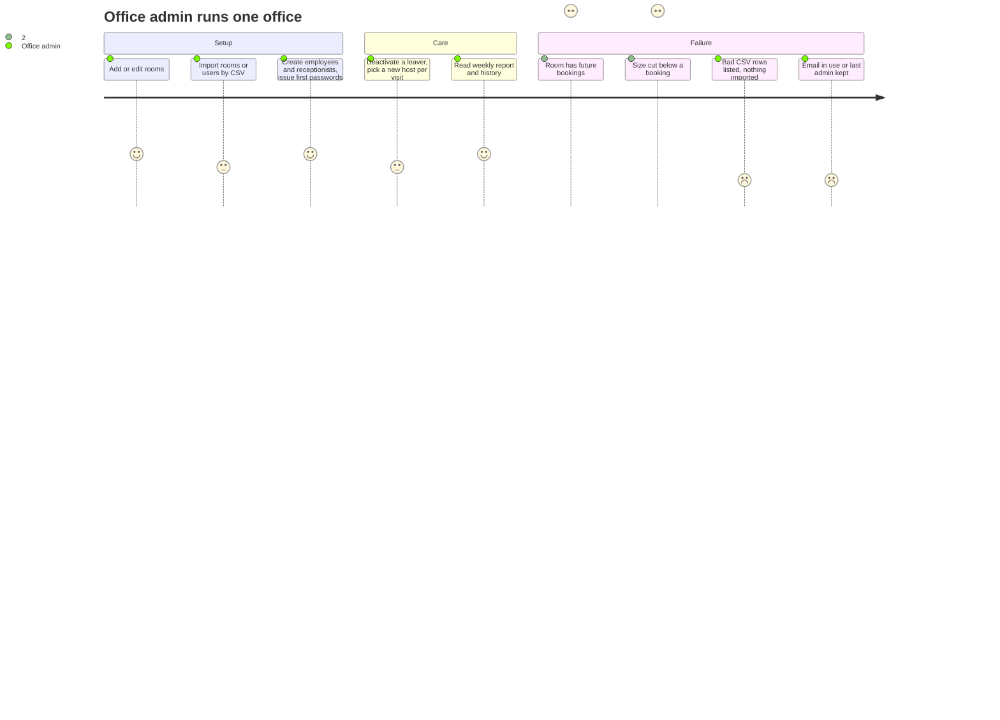
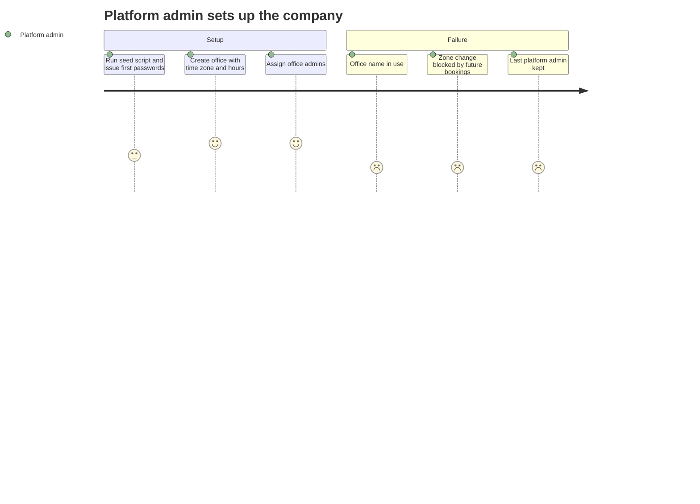
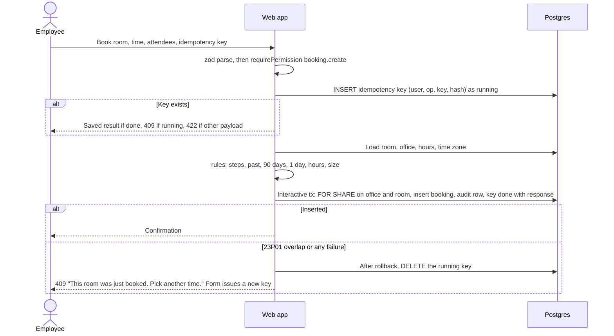
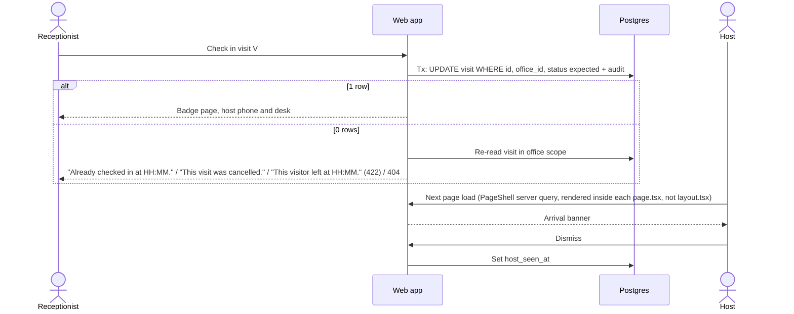
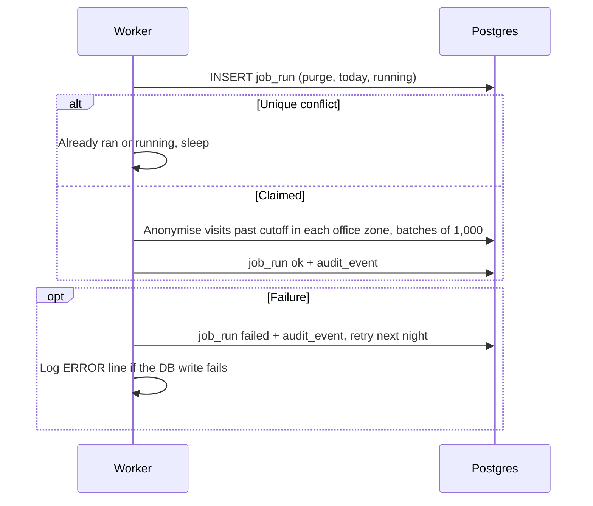

# Design: E-001 Room booking and visitor management

## Context
Rooms and visitors at several offices run on email, paper and memory. This causes double bookings, lost visitors and no visit record.
Users are platform admins, office admins, employees and receptionists. A worker anonymises visitor data nightly.
Constraint: Next.js 16, Prisma 7 and Postgres 18 in Docker on client hosts (SOW 7). No SSO, email, text alerts or calendar links. Standards cited are in the bls-engineering plugin `standards/` folder.

Threat note: an insider receptionist reads visitor data (scoped by office, logged); lockout used to block a desk (per-IP limit, admin unlock by reset); CSV abuse (schema, size, formula checks, one import per office); spoofed proxy headers (one trusted hop); sole platform admin locked out (last-platform-admin guard, break-glass script).

## Goals and non-goals
Goals:
- No double bookings, even under concurrent requests (AC-11, AC-12, AC-36, AC-37).
- Book, change, cancel and repeat bookings within office hours and room size (AC-07, AC-23 to AC-28, AC-33 to AC-38, AC-55, AC-74 to AC-80, AC-82).
- Pre-register, check in, badge and check out visitors, and reach the host fast (AC-19 to AC-22, AC-39 to AC-46, AC-87, AC-88, AC-91).
- Four fixed roles, scoped by office, with tiered account creation (AC-01 to AC-06, AC-13 to AC-17, AC-56, AC-58, AC-59, AC-89).
- Locked activity history and live weekly reports (AC-08, AC-50 to AC-53, AC-57, AC-90).
- Visitor data anonymised after 90 days (AC-09, AC-10, AC-18, AC-70, AC-83).
- Bulk load by seed script and CSV import (AC-60 to AC-64). Sign-in and sessions (AC-47 to AC-49, AC-71, AC-72, AC-84, AC-85).
- Fast, accessible, sized for 3,000 users (AC-29, AC-65 to AC-69, AC-73).

Non-goals:
- Payments, calendar links, single sign-on, mobile apps, badge printers or kiosks, text or email alerts.
- Custom roles, monthly repeats, links to other systems (HR, access control). Deleting offices.

## User journeys

## HLD
Components:
| Component | Job | Talks to |
|---|---|---|
| Web app (`web` container) | Pages, server actions, `/api/health`. Bound to the proxy network only | Postgres |
| Worker (`worker` container, same image) | Four jobs in one loop: purge visitors, prune sessions, prune idempotency keys, prune sign-in attempts ([ADR-0007](../../docs/adr/0007-worker-container-for-jobs.md), revisit at four jobs: one loop still fits) | Postgres |
| Postgres 18 (`db` container) | Data, constraints, triggers. Port not published | None |
| Seed and admin scripts | `scripts/seed.ts`, `scripts/break-glass.ts` (new platform admin temp password, writes an audit event and a log line) | Postgres |
| Reverse proxy (client IT) | TLS, one trusted hop, sets `X-Forwarded-For` | Web app |
| Backups (client IT) | Daily encrypted `pg_dump`, 7 days kept (AC-70) | Postgres |

## LLD
Modules:
| Module | Path | Rules file | EARS homes |
|---|---|---|---|
| auth | `src/domain/auth/` | `rules.ts`: lockout window, password length, session expiry | AC-47 to AC-49, AC-71, AC-72, AC-84, AC-85 |
| access | `src/contracts/permissions.ts` (roles, actions, reach, `scopeFor`), `src/domain/access/` | `rules.ts`: last office admin, last platform admin | AC-01 to AC-06, AC-13 to AC-17 |
| office | `src/domain/office/` | `rules.ts`: hours, time zone change, room fields, size change | AC-30 to AC-32, AC-34, AC-54, AC-81, AC-86 |
| user | `src/domain/user/` | `rules.ts`: deactivation, host reassignment, email unique | AC-19, AC-56, AC-58, AC-59, AC-89 |
| import | `src/domain/import/` | `rules.ts`: row checks, 5,000 cap, all or nothing | AC-60 to AC-64 |
| booking | `src/domain/booking/` | `rules.ts`: steps, window, length, hours, capacity, edit rights | AC-07, AC-11, AC-12, AC-23 to AC-28, AC-33, AC-35 to AC-38, AC-55, AC-57, AC-78 to AC-80, AC-82 |
| series | `src/domain/series/` | `rules.ts`: expand dates, skip closed days, 90-day cap | AC-74 to AC-77 |
| visit | `src/domain/visit/` | `rules.ts`: fields, date, state moves, banner | AC-20 to AC-22, AC-39 to AC-46, AC-87, AC-88, AC-91 |
| history | `src/domain/history/` | `rules.ts`: event shape without personal data | AC-10, AC-50 to AC-52 |
| report | `src/domain/report/` | `rules.ts`: week bounds, room use ratio, visitor counts | AC-08, AC-53, AC-90 |
| purge | `src/domain/purge/`, `src/worker/` | `rules.ts`: cutoff per office zone, fields cleared | AC-09, AC-18, AC-83 |
| platform | `src/lib/`, `next.config.ts`, Docker files | None: config | AC-29, AC-65 to AC-70, AC-73 |

Route map. Any action not listed is denied. "Office" means the record's office equals the caller's office.
| Page or action | Path | Permission key: who | Story |
|---|---|---|---|
| Health check | `/api/health` | `public`: Docker healthcheck, returns status only | E-001/S-01 |
| Sign in, sign out | `/sign-in` | `public`: entry point | E-001/S-01 |
| Set new password | `/account/password` | `account.password`: self, current password required | E-001/S-01 |
| Role home | `/` | any: platform admin to `/admin/offices`, office admin and receptionist to `/reception`, employee to `/rooms` | E-001/S-01 |
| Offices list, create, time zone, hours | `/admin/offices`, `/admin/offices/[officeId]` | `office.manage`: platform admin. `office.hours` for office admin of office: pending Open point 8, off until signed | E-001/S-02 |
| Room add, edit, remove | `/admin/offices/[officeId]/rooms/[roomId]` | `room.manage`: platform admin, office admin of office | E-001/S-02 |
| Users list, create, edit, reset, deactivate, issue passwords | `/admin/users`, `/admin/users/[userId]` | `user.manage`: platform admin any user. Office admin only employees and receptionists of office, `role` and `office_id` read-only. Bulk issue: only users with no password yet, admin re-enters own password | E-001/S-03 |
| CSV import | `/admin/import` | `import.run`: same reach as `user.manage`, one run per office at a time | E-001/S-04 |
| Free rooms | `/rooms` | `booking.create`: all roles, any office | E-001/S-05 |
| Book, my bookings | `/bookings/new`, `/bookings` | `booking.create`: all roles, any office | E-001/S-06 |
| Change or cancel booking | `/bookings/[bookingId]` | `booking.manage`: owner, platform admin, office admin and receptionist of room's office | E-001/S-06 |
| Repeat (from `/bookings/new`), cancel one or all | `/bookings/series/[seriesId]` | `booking.manage`, same rule per series | E-001/S-07 |
| Pre-register, my visits, cancel | `/visits/new`, `/visits` | `visit.create`: host is the caller. `visit.cancel`: host, platform admin, office admin and receptionist of office | E-001/S-08 |
| Dismiss arrival banner | PageShell action | `visit.seen`: host only, scoped by `host_id` | E-001/S-09 |
| Today view, walk-in, check in and out, badge | `/reception`, `/reception/visits/new`, `/reception/visits/[visitId]`, `.../badge` | `visit.desk`: receptionist and office admin of office, platform admin | E-001/S-09 |
| Activity history | `/history` | `history.view`: platform admin all, office admin and receptionist of office | E-001/S-10 |
| Weekly reports | `/reports` | `report.view`: same as history | E-001/S-11 |
| Purge, prune | worker | `system` principal: purge and prune only | E-001/S-12 |

Security:
- Scope per resource via `scopeFor(session, resource)` in `permissions.ts`. Own bookings and visits match `owner_id` or `host_id` at any office. Office records match `room.office_id` or `visit.office_id`. Other-office records return 404 (AC-05). Same-office records without the right return 403 (AC-06, AC-16, AC-28).
- Inputs: strict zod schemas in `src/contracts/<entity>.ts` for every body, `[param]` and searchParam. Limits: names 120, email 254, phone 30, desk 60, password 12 to 128, CSV row schema per entity. Specs list each schema.
- Passwords: Argon2id. Unknown email runs a dummy verify. One home for failures: `sign_in_attempt` (email hash, IP, time). Lockout counts failures by email hash since the last success, so known and unknown emails lock alike after 5 in 15 min (AC-48). An admin reset deletes the target's attempt rows in the same transaction. The IP limit counts distinct email hashes only: from 30 in 15 min each attempt waits 1 s more, from 100 the IP gets 429 with `Retry-After`. A shared office address with normal sign-in traffic stays under it. The inactive and expired temporary password messages show only after the password verifies (AC-84).
- Sessions: 256-bit CSPRNG token, `__Host-session` cookie, `HttpOnly`, `Secure`, `SameSite=Lax`. SHA-256 stored. New token at sign-in and password change. Sign-out deletes the row and clears the cookie. Role and status read from `users` each request. `must_change_password` enforced inside `requirePermission`. Expiry 12 h absolute (AC-71). Return path after sign-in: same-origin relative path starting with one `/`, checked by zod, else role home.
- Reset and first passwords: CSPRNG, 16 alphanumeric characters, shown once, expire after 7 days. Reset and deactivation delete all of the target's sessions. Password change deletes the caller's other sessions. Bulk download sends `no-store`. Each issued user gets an audit event ([ADR-0011](../../docs/adr/0011-first-credentials.md)).
- Guards: last office admin (AC-17) and last active platform admin. `scripts/break-glass.ts` issues a platform admin temp password from the host shell.
- CSV: parsed, never trusted by MIME. 2 MB, 5,000 rows. Cells starting `= - @ \t \r` rejected, except full-cell patterns `^\+?[0-9 ]{6,30}$` in phone and `^-?[0-9]{1,3}$` in floor. Parser: [ADR-0008](../../docs/adr/0008-csv-parser.md).
- No personal data in URLs. Visitor search is a server action POST. DTOs only from `server-only` modules. `password_hash` never leaves `src/data/user.ts`. The host picker returns name and desk only. Host phone shows only in `visit.desk` views (AC-20).
- Raw SQL only by `$queryRaw` tagged templates. `$queryRawUnsafe` banned by lint.
- Headers per `standards/security.md`, nonce-based CSP. `Cache-Control: no-store` on reception, badge, visits and admin user pages. `serverActions.allowedOrigins` holds the client hostname only.

Secrets (all from runtime env, parsed in `src/lib/env.ts`, owner client IT):
| Secret | Used by |
|---|---|
| `DATABASE_URL_WEB` (role `app_web`) | web |
| `DATABASE_URL_WORKER` (role `app_worker`) | worker |
| `DATABASE_URL_MIGRATOR` (role `app_owner`) | migrate deploy, seed, break-glass |
| `APP_ORIGIN` | CSRF origin check, cookies |

Logging: JSON lines per `standards/logging.md`. Events: request summary, sign-in ok and failed, lockout, authz denied, password reset and change, session revoke, role change, deactivation, validation failure, import result (row numbers and reason codes), booking conflict, job runs. Redact all personal data: user and visitor names, emails, phones, desks, client IP. Log user id only.

Errors: RFC 9457 under `/problems/`. `instance` is the request id. DB errors map to these types in `src/lib/errors.ts`. Server actions return the same `type` and `detail`.
| Type | Status | Used for | Shown to user |
|---|---|---|---|
| `validation` | 400 | Shape, missing fields (AC-23, AC-40, AC-86) | Message at each field |
| `unauthenticated` | 401 | No or expired session, wrong details (AC-85) | "Please sign in again." / AC-85 text |
| `forbidden` | 403 | Role not allowed (AC-06, AC-16, AC-28) | "You do not have access to this." |
| `not-found` | 404 | Missing or other-office record (AC-05) | "We could not find this item." |
| `booking-conflict` | 409 | Overlap (AC-12, AC-37) | AC-12 text |
| `version-conflict` | 409 | Changed since loaded | "Someone changed this. Reload to see it." |
| `request-in-progress` | 409 | Same idempotency key still running | "This is still saving. Wait a moment." |
| `request-changed` | 422 | Same key, other payload | "This request changed. Submit it again." |
| `rule-violation` | 422 | Business rules (AC-17, AC-24 to AC-26, AC-31, AC-32, AC-42, AC-55, AC-62, AC-64, AC-72, AC-75, AC-79, AC-84, AC-87 to AC-89) and the four below | EARS text, or: "This temporary password has expired. Ask your admin for a new one." / "Move or cancel future bookings before changing the time zone." / "Another import for this office is running. Try again in a minute." / "The company needs at least one platform admin." |
| `locked` | 429 | Lockout and IP limit (AC-48) | "Too many attempts. Try again in 15 minutes." |
| `internal` | 500 | Our fault | "Something went wrong. Try again. If it happens again, give reference <id> to your admin." |

UX rules (detail per page lives in spec section 2; tokens in S-00):
- Times in 24-hour form, dates as "Mon 16 Nov 2026". Office zone short name beside times on cross-office pages and in AC-55 copy. Closed day copy: "This office is closed on <day>." DST gap slots hidden.
- `/rooms` is a list of rooms, each with labelled slot buttons of at least 24 by 24 px. Booked state shown by text, not colour alone. No drag.
- Forms: error summary takes focus, fields use `aria-describedby`, results announce in `role="status"`. Submit disabled while pending. After 409, inputs stay and free times refresh. `autocomplete` on email, password and phone fields.
- Session: warning 5 minutes before the 12 h end. The fixed end is a security exception to WCAG 2.2.1, accepted risk for the signer. Form drafts are kept in `sessionStorage`, keyed by user id, and restored after sign-in on the same page only for the same user. A different user or sign-out clears them. Password fields are never stored.
- Arrival banner: "Your visitor <name as entered> has arrived at reception." Inserted into a `role="status"` region after hydration so screen readers announce it. Several arrivals stack. Dismiss sets `host_seen_at`.
- Host picker: combobox scoped to the office, shows name and desk. Used for walk-ins and deactivation.
- Sign-in page hint: "Forgot your password? Ask your office admin to reset it." Temp password panel: "Shown once. Give it to the user in person." with a Copy button.
- Today view has a Refresh button and polls every 60 s with a Pause control (WCAG 2.2.2). A refresh keeps focus and the search input. Reports show data tables. History shows "Visitor V-3F2A" and plain verbs. Anonymised visits show "Visitor details removed".
- CSV errors show row number, column and reason in plain words. Repeated hour on fall-back days shows the zone short name.
- Badge: one per page, large visitor name, Print button. Layout: 375 px tables stack into cards, one column. 768 px two-column forms. 1280 px today view splits bookings and visitors side by side. Menus per role are in each spec section 2.

## NFRs
| Area | Target | How checked |
|---|---|---|
| Double booking | 0 overlaps (AC-11, AC-12) | Integration test: 20 parallel creates on one slot, exactly 1 succeeds |
| Page speed | LCP p75 within 2.5 s over 5 runs per page (AC-67) | Playwright on staging, Chrome, 10 Mbps and 40 ms RTT profile (Open point 3) |
| Server time | 95% within 500 ms (AC-68) | k6 `http_req_duration p(95)<500` |
| Load | 200 concurrent users, errors under 1% (AC-69) | k6 200 VUs, 3 s think time. Mix: 50% view rooms, 20% book, 15% today view, 10% visits, 5% reports. Server actions scripted as form POSTs |
| Volume | 20 offices, 300 rooms, 3,000 users, 500 visitors a day (AC-65) | `tests/load/seed.ts` |
| Accessibility | WCAG 2.2 AA (AC-66), 375 px (AC-29) | axe in every `tests/ui` spec at 375, 768, 1280. Keyboard Tab test |
| Browsers | Latest two Chrome, Edge, Safari, Firefox (AC-73) | Playwright chromium, msedge, webkit, firefox e2e smoke |
| Privacy | 90-day anonymise (AC-09), 7-day backups (AC-70) | Purge integration test with fixed clock. Runbook check at release |
| Sessions | 12 h absolute (AC-71) | Unit test on rule, e2e with fake clock |
| Security | Auth in every action, scope per record | `check-auth-in-actions.sh`, authz matrix integration test over every route |
| Availability | Open point 1 | Client IT monitoring |

## Data design
Third normal form by default. No denormalisation. `audit_event.office_id` is an immutable snapshot, not a copy kept in sync. Ids are uuid v7 made in the app, except `session.token_hash` and composite keys. Audit rows have no `updated_at`. Times are UTC `timestamptz`, shown in the office zone ([ADR-0009](../../docs/adr/0009-time-zone-handling.md)). Raw-SQL objects, each with an existence test in S-00: exclusion constraint, partial uniques, `lower(email)` unique, CHECKs, audit triggers, role grants.
| Entity | Access pattern | Query shape | Consistency | Volume | Decision | Reason |
|---|---|---|---|---|---|---|
| Office | Q1 list. Q2 by id (every rule) | Q1 order by name. Q2 PK | strong | 20 | Unique `name`, IANA `time_zone`, `version`. Zone change blocked while future bookings exist | Small. Version guards hours edits |
| OfficeHours | Q1 by office and weekday | office_id, weekday | strong | 140 | PK `(office_id, weekday)`, `opens_at`, `closes_at`. No row means closed | PK serves Q1 (AC-54) |
| Room | Q1 live rooms of office with size >= N. Q2 by id | office_id, deleted_at null, size | strong | 300 | Soft delete `deleted_at`. Partial unique `(office_id, lower(name)) where deleted_at is null`. `version` | Unique serves Q1 and AC-31. History keeps old rooms |
| User | Q1 by email. Q2 by office. Q3 active admins of office | lower(email); office_id, role | strong | 3,000 | Enum `role`, `office_id` null only for platform admin (CHECK). `password_hash` null until first password. Unique `lower(email)`. Index `(office_id, role)`. `phone`, `desk`, `deactivated_at`, `must_change_password`, `temp_password_expires_at`, `version` | Q1 unique. Q2, Q3 share one index |
| SignInAttempt | Q1 failures by email hash in 15 min (lockout). Q2 distinct email hashes by IP in 15 min (IP limit) | email_hash, at; ip, at | strong | 10,000 live | The only home for failure counts. Indexes `(email_hash, at)`, `(ip, at)`. Pruned daily by the worker | Shared store (api.md RC7). One store avoids two counts that disagree |
| Session | Q1 by token hash. Q2 delete by user | PK; user_id | strong | 3,000 live | PK `token_hash`, FK index `user_id`, `expires_at`. Pruned daily | Q1 every request |
| Booking | Q1 bookings of rooms for a day. Q2 my future bookings. Q3 create. Q4 future bookings of room | Q1 raw SQL with the exact constraint expression and `status = 'confirmed'`. Q2 owner_id, starts_at. Q4 room_id, starts_at | strong | 300,000 a year | `starts_at`, `ends_at`, `attendees`, enum `status`, `series_id`, `version`. `EXCLUDE USING gist (room_id WITH =, tstzrange(starts_at, ends_at, '[)') WITH &&) WHERE (status = 'confirmed')`. Btree `(room_id, starts_at)`, `(owner_id, starts_at)`, FK `series_id` | Race-proof guard ([ADR-0006](../../docs/adr/0006-double-booking-exclusion-constraint.md)). `[)` allows back to back. Cancelled rows stay (AC-57) |
| BookingSeries | Q1 by id with bookings | id; series_id | strong | 20,000 a year | Enum `pattern`, `until_date`. One `INSERT ... SELECT unnest(dates) ON CONFLICT DO NOTHING RETURNING`. Closed days skipped and listed | One overlap home ([ADR-0010](../../docs/adr/0010-recurring-as-materialised-bookings.md)). Max 90 rows (daily, seven-day office) |
| Visit | Q1 today by office. Q2 my visits. Q3 unseen arrivals. Q4 purge. Q5 earlier days still checked in | Q1 office_id, visit_date. Q2 host_id, visit_date. Q3 host_id, host_seen_at null. Q4 visit_date, anonymised_at null. Q5 office_id, status, visit_date | strong | 125,000 a year, 31,000 with personal data | `name`, `email`, `phone`, `company` nullable, `visit_date`, enum `status`, `checked_in_at`, `checked_in_by`, `checked_out_at`, `host_seen_at`, `anonymised_at`, `version`. CHECKs tie status to timestamps. Indexes Q1, Q2, partial `(host_id) where host_seen_at is null and status = 'checked_in'`, partial `(visit_date) where anonymised_at is null`, partial `(office_id) where status = 'checked_in'`, FK `checked_in_by` | One index per query. No visitor master table |
| AuditEvent | Q1 office history newest first. Q2 all offices. Q3 by entity | Q1 office_id, at desc, id desc. Q2 at desc, id desc. Q3 entity | strong | 1.9 million a year | Append only. Trigger raises on UPDATE, DELETE and TRUNCATE. `app_web`, `app_worker` have INSERT and SELECT only. Indexes for Q1, Q2, Q3. Retention: Open point 7 | AC-51 in the database. Visitors by id only (AC-52) |
| IdempotencyKey | Q1 lookup | user_id, scope, key | strong | 50,000 live | Unique `(user_id, scope, key)`, `request_hash`, `status`, `response` (ids only), `created_at`. Worker prunes after 24 h | api.md: 409 running, 422 other payload |
| JobRun | Q1 claim today's run | job, run_date | strong | 1,460 a year (4 jobs) | Unique `(job, run_date)`, enum `result`. Row inserted first as the claim | Stops double runs |
| Reports | Q1 booked and open minutes per room for a week. Q2 checked-in visits per day | Aggregates on Booking, OfficeHours, Visit | strong | Per page view | No table. SQL returns raw minutes and counts. Ratio computed in `src/domain/report/rules.ts` (AC-08, AC-53, AC-90) | Rule stays out of SQL |

Transactions (interactive form; a guarded write that changes 0 rows throws so the audit row rolls back, except the series insert):
| Write | Invariant | How |
|---|---|---|
| Any change plus audit row | Both or neither (AC-50) | Interactive tx, throw on count 0 |
| Office time zone change | No future booking shifts (ADR-0009) | Lock office row, count future bookings. Booking insert takes `FOR SHARE` on office and room (ADR-0012) |
| Demote or deactivate platform admin | One active platform admin `pg_advisory_xact_lock(2, 0)` (class 2: platform admin guard), count active platform admins (ADR-0012) |
| Room removal | No confirmed future booking on a removed room (AC-32) | Lock room row, count future bookings, set `deleted_at`. Booking insert takes `FOR SHARE` on the room ([ADR-0012](../../docs/adr/0012-override-guards-in-transactions.md)) |
| Demote or deactivate office admin | One active admin per office (AC-17) | Lock office row, count active admins (ADR-0012) |
| Deactivate user | No future bookings or unassigned hosted visits (AC-58, AC-59) | One tx: lock office, admin guard, cancel bookings, reassign hosts, reject if any visit unmapped, delete sessions |
| CSV import | All rows or none (AC-62) | `pg_try_advisory_xact_lock(1, hash(office_id))` (class 1: imports). False returns "Another import for this office is running." Hash nothing inside. One tx, `createMany`, 30 s timeout ([ADR-0013](../../docs/adr/0013-override-single-import-transaction.md)) |
| Series create | Free dates booked, clashes listed (AC-76) | One tx, one multi-row insert. 0 rows booked is not an error: "No dates were free. Nothing was booked." above the full clash list |
| User edits | No lost update | `version`, `updateMany where id and version`, 0 rows returns 409 |

## Open points
| # | Question | Owner | Needed by | Status |
|---|---|---|---|---|
| 1 | Monthly uptime target | Client IT | eng-release | open |
| 2 | Client confirms additions beyond the SOW: platform admin and office scoping, CSV import, recurring bookings, capacity check, arrival banner | Signer | Sign-off | open |
| 3 | Client accepts the "office wifi" test profile: 10 Mbps, 40 ms RTT | Client IT | E-001/S-13 | open |
| 4 | Client IT runs the TLS proxy and encrypted daily backups kept 7 days, with a named access list | Client IT | eng-release | open |
| 5 | Install Node 26 Active LTS (this machine has 22) and pnpm | Kavin Pasupathy | eng-build | open |
| 6 | Push the intake commit as `main` on GitHub | Kavin Pasupathy | eng-build | open |
| 7 | Activity history retention (proposal: 2 years, then archive) | Signer | E-001/S-10 | open |
| 8 | Office admins may edit their own office's opening hours (`office.hours`) | Signer | E-001/S-02 | open |
| 9 | Chair fixed the round 3 items after the final round. They were not re-reviewed: idempotency key deleted on failure, form drafts keyed by user, import try-lock, attempt count since last success | Signer | Sign-off | open |
| 10 | Accept the 12 h fixed session end as a WCAG 2.2.1 security exception, with a 5-minute warning and drafts kept | Signer | Sign-off | open |

Every EARS ID in `epic.md` maps to a module above. None is unmapped.

## Review record
Three advisory reviewers. Max 3 rounds. The chair closes after round 3.
| Round | Reviewer | Verdict | Items |
|---|---|---|---|
| 1 | design-architect | Request Changes | 35 raised (10 Major, 25 Minor). All fixed. 27 partly: office admin hours to Open point 8. 34: Prisma 7, uuid v7 made in app. 35: retention to Open point 7 |
| 1 | design-security | Request Changes | 30 raised (1 Critical, 13 Major, 16 Minor). All fixed. 11 partly: limits set here, full schema list in specs |
| 1 | design-ux | Request Changes | 36 raised (21 Major, 15 Minor). Fixed 33. Declined 6 (five states per route belong in spec section 2), 21 (tokens are set in S-00 T-04 and written to `docs/ui/interface-rules.md` in S-00 T-06), 24 (field copy belongs in spec section 2). 20 partly: stacking rule here, per-page layout in specs. 9 and 11 duplicate security 6 and architect 10 |
| 2 | design-architect | Request Changes | 11 raised (1 Major, 10 Minor). All fixed: idempotency key claimed as running first, worker lists 4 jobs, series cap 90 and no throw on 0, reach moved to permissions, `office.hours` off until Open point 8, PageShell per page, import advisory lock, zone change and platform admin guards, one failure store, count corrected |
| 2 | design-security | Request Changes | 9 raised (1 Major, 8 Minor). All fixed: IP limit counts distinct emails with delay then block, session wording, lockout by email hash, bulk issue limits, picker without phone, sign-out row delete, platform admin guard and break-glass audit, `visit.seen`, return path check |
| 2 | design-ux | Request Changes | 14 raised (2 Major, 12 Minor). Fixed 13: email-hash lockout, IP limit, platform admin failures, check-in copy, 404 and 500 copy, CSV floor, banner after hydration, session exception as accepted risk with drafts kept, 768 and 1280 lines, CSV error format, repeated hour, Pause on polling, four new messages. Declined 1 partly: per-role menus live in spec section 2 |
| 3 | design-architect | Request Changes | 3 raised (1 Major, 2 Minor). Fixed by chair after round 3, not re-reviewed (Open point 9) |
| 3 | design-security | Approve | 4 new Minor. Fixed by chair: drafts keyed by user, expired message after verify, reset clears attempts, full-cell CSV patterns |
| 3 | design-ux | Request Changes | 3 raised (1 Major, 2 Minor). Fixed by chair after round 3, not re-reviewed (Open point 9). Review closed: round 3 finished |

## Sign-off
The signer signs by setting status to signed, signed_by and signed_on in the front matter.
Items still open after round 3 are listed under Open points for the signer.
